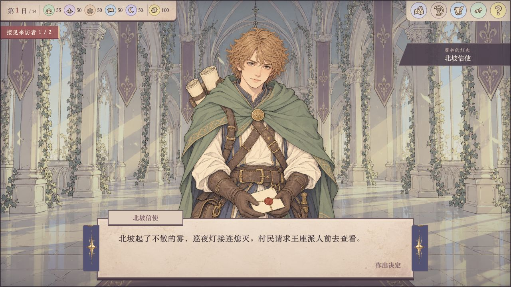
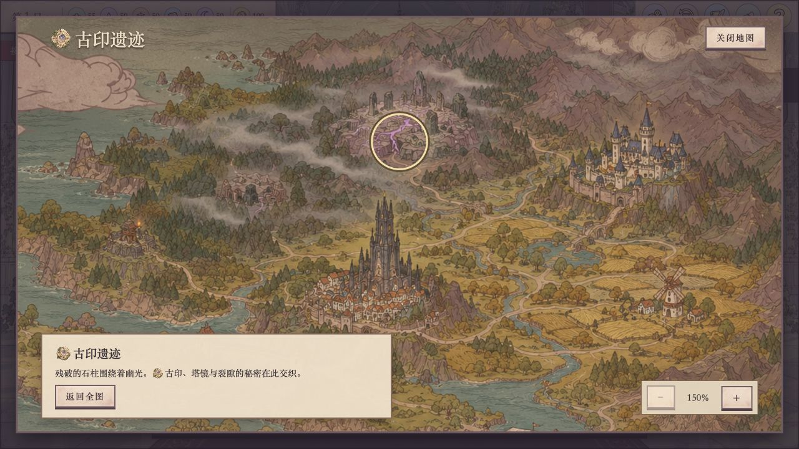

# 暮塔之主


塔楼重新打开大门，来访者已在门外等候。有人带来急信，有人请求粮食，也有人希望你派骑士走一趟北坡。十四天里，每一次答复都会改变各方的支持与国库；到了圆桌前，你还需要决定谁去处理这些事情。

《暮塔之主》是一款中文奇幻王国管理游戏。接见来客、安排骑士、建设塔楼，在彼此牵连的事务中作出选择，看看王国最终走向何处。

## 玩法

- **接见来访者**：听取请求，在民心、贵族、商会、学者、秘仪与国库之间权衡。
- **派遣骑士**：根据任务需求、骑士属性和期限分配人手。任务完成时转动转盘，揭晓结果。
- **经营塔楼**：建设房间、制作与装备物品，也可以与骑士交谈。
- **查看疆域**：从王国地图进入各地区，了解暮塔、雾林、旧桥与渡口等地点。
- **回溯时光**：回到已经历的日子重新选择，见闻仍会保留。

序章可点击对话框或按空格推进，也能打开文字记录。其余操作以鼠标或触屏点击为主。

## 游戏画面




## 关于本项目

本项目参考 [Sovereign Tower](https://wildwits.itch.io/sovereign-tower) 的玩法与画面布局，重新制作代码和图像素材。序章使用创作者提供的原作截图文案的中文翻译，其余章节为原创内容；本项目并非原作的完整移植。

## 本地运行

需要 Node.js 和星匣 CLI：

```bash
npm test
npm run check
star-letter check .
star-letter dev game --open
```

请通过星匣预览页体验。也可以运行 `python3 -m http.server 8080 --directory game` 后访问本机页面；独立页面只保留本次页面的进度，星匣环境使用 GameSDK 云存档，读写依赖平台能力和玩家授权。

## 项目结构

- `game/app.mjs`、`game/style.css`：界面和交互。
- `game/opening.mjs`：序章与文字记录。
- `game/engine.mjs`、`game/content.mjs`：游戏规则与故事内容。
- `game/map.mjs`、`game/wheel.mjs`：地图与任务转盘。
- `game/save.mjs`、`game/save-codec.mjs`：存档与版本转换。
- `game/assets/`：场景、人物与界面素材。
- `promo/`：供宣传使用的游戏画面。
- `tests/`：核心规则与存档检查。
